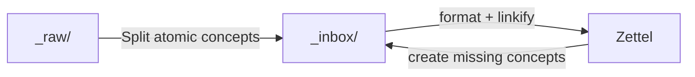

> [!Note]
> Even though this blog post is about AI, this text has been fully human written.

I have been using Obsidian for my personal notes since the beginning of 2022, so for over four years at the time of writing. I very quickly found that the best organisation system for me was a Zettelkasten approach. A single flat folder where all my notes get stored in, surfaced via links to and backlinks from other notes.

At the beginning this was a wonderful concept. I wrote new notes in a `_inbox/` folder, linked them up to other notes and when I was happy with it I moved it to the `Zettel/` folder. Over time the number of notes grew and grew and i started to open obsidian less and less. When I wrote something down, those notes accumulated in the `_inbox/` and I did not have the time nor motivation to properly interlink the concepts and process the notes such that i am happy for them to be moved to the Zettel folder.

But this changed when I came across an article that introduces a framework for how to let an AI agent, such as Claude Code, do this work instead. This instantly resonated with me and for the last week I spent some time to build my own workflow on how I want to leverage Claude in my note taking system.

## The AI Supported Note Taking Workflow



I used to only have an `_inbox` and a `Zettel` folder, but I decided to also add a new `_raw` folder to my workflow, one that I would not have added if it were not for the help of AI.

Lets go over the full workflow, I will share the tools and prompts with you afterwards.

### Step 0 (optional) - The `_raw/` folder

Sometimes I come across interesting information in some form or another. This could be a blog post or other site on the internet. A chat log with a fellow human or with an AI. Or any other document that is primarily text based.

I copy this information into a basic markdown file in the `_raw/` folder, without formatting splitting or any other processing. Just a unstructured piece of "data".

I then use Claude Code to extract atomic notes, pieces of information that are a single coherent concept, into new notes in the `_inbox/` folder. Those new notes must not have any special format, but they should, if possible, link to the source of the data. The original file in the `_raw/` folder is then deleted.

### Step 1 - The `_inbox/` folder

This is the folder where I create my own new notes. Those notes are not supposed to be of high quality or particularly information dense. It's just a place for me to write something down quickly.

As mentioned above, I used to manually format each note, find relevant other notes and interlink them. Now I use Claude Code for this. If effortlessly brings the notes exactly into the right format, with the right frontmatter and backmatter information and correcting any spelling or grammatical errors. It also searches for relevant other notes in the `Zettel/` folder and links to them. Additionally I want each note to be reachable from a central `_overview.md` note in the vault root, either by adding a link to the `_Overview.md` or by linking to or from a note that is already reachable from the `_Overfiew.md` file.

If the note references a higher level concept, Claude is instructed to generate a basically empty new note for it in the concept, which is then linked from the original note.

I have setup `qmd` and `obsidian-graph-mcp` as tools for Claude Code, which it uses to find relevant notes and reason about the linked notes graph. I will get into those tools below.

### Step 2 - Kaizen - continuously improvement

For newly added notes, the quality of the links should be pretty good, but sometimes some connections get missed. And in my Zettelkasten there are almost a thousand pre existing notes, that have been linked by hand and where I undoubtedly have missed many related notes.

This is where _Kaizen_ comes in.

> [!INFO]
> Kaizen is a Japanese concept of continuous improvement. The goal is to improve the notes bit by bit, instead of spending a lot of effort into making the notes perfect (if such a thing even exists) in one go.

Claude Code is instructed to select 5 notes either by random, or that are not reachable from my central `_Overview.md` note and perform the same operations as in Step 1. Claude ensures that the note is formatted properly and that all relevant links are present.

## Resources

Now that the workflow is clear I want to quickly go over the tools and skills I use to accomplish this workflow.

### Tools

#### `qmd`

**qmd** is a local markdown search engine. It uses keyword and semantic vector search to find the most relevant notes to any query or concept. It is available as an mcp server or as a CLI.

#### `obsidian-graph-mcp`

I found that Claude Code spent a long time traversing links and reading lost of files, just so it can reason about forward and backward links and the reachability from the `_Overview.md` file. I build a simple go MCP server that solves this problem. It exposes just a few graph tools that allow Claude Code to quickly make decisions, instead of first having to read tens of files to get an overview.

## Claude Code skills

I considered setting up a claude code plugin so it would be easier for you to install the skills, but I decided against it. Those skills are very particular to my workflow, and I expect everyone has different preferences on how Claude should behave with their notes.

For example I do have other notes folders that I don't want Claude to read or modify, have different notes templates and so on. Feel free to copy and modify those skills to your liking.

> [!NOTE]
> If you like this post, have any comments of improvements, don't hesitate to reach out to me.

### process-raw Skill

```markdown
---
name: process-raw
description: Process a raw text file from _raw/ into one or more atomic notes in _inbox/. Parses unstructured pasted text, splits it into atomic notes, and writes them to _inbox/ for further processing.
argument-hint: [raw-file-name]
allowed-tools:
  - Read
  - Write
  - Glob
  - Grep
---

Process a raw text file from the `_raw/` folder into one or more atomic notes in `_inbox/`.

The raw file to process is: $ARGUMENTS

## Instructions

1. **Find the raw file**: Search for the file in `_raw/`. If $ARGUMENTS is ambiguous or missing, list all files in `_raw/` and ask which one to process.

2. **Read the raw file**: Understand the full content — it may be pasted text, a web article, meeting notes, a brain dump, or any unstructured input.

3. **Extract atomic notes**: Break the content into one or more atomic notes. Each note should:
   - Cover exactly one concept, idea, thing, or topic
   - Be self-contained and independently meaningful
   - Not be artificially split if the content is already a single coherent idea

4. **Determine a title for each note**: Choose a clear, descriptive title following vault conventions:
   - Things: `Name (Type)` — e.g. `Sourdough Bread (Recipe)`, `Obsidian (Software)`
   - Concepts: plain noun phrase — e.g. `Zettelkasten`, `Swim Drills`

5. **Write each note to `_inbox/`**: Create a minimal note file at `_inbox/<Title>.md` with:
   - A `# <Title>` H1 heading
   - The core content, cleaned up and written in clear prose (not just a copy-paste)
   - Preserve any important details, quotes, or references from the raw text
   - Do NOT add wikilinks, or Related/Metadata sections yet, those are added when processing the `_inbox/`
   - Add custom metadata from the `_raw` file in the yaml frontmatter, author, source, timestamp, other meaningful data.

6. **Delete the raw file**

7. **Report**: List each note created, its title, and a one-line summary of its content.

8. **Stop**: Do not attempt to run any skills on the newly created notes — they will be processed later with the `process-inbox` skill.

## Notes

- If the raw content is a single coherent idea, create just one note.
- If the raw content contains multiple distinct concepts, create multiple notes — one per concept.
- Preserve source attribution if present (URL, author, date) in the frontmatter.
```

### process-inbox Skill

```markdown
---
name: process-inbox
description: |
  Process a note from _inbox/: Use when a note in _inbox/ is ready to be integrated into the vault.
argument-hint: [note-name]
allowed-tools:
  - Read
  - Edit
  - Glob
  - Grep
  - Bash(rm:*)
---

Process a note from `_inbox/` into the vault.

The note to process is: $ARGUMENTS

## Instructions

1. **Find the note**: Look for it in `_inbox/`. If $ARGUMENTS is ambiguous, list candidates and ask which one.

2. **Format the note**: Run the `format` skill on the note.

3. **Linkify the note**: Run the `linkify` skill on the note.

4. **Read the note**: Understand its content and determine the correct destination folder:
   - Starts with `@` and is a person's name → `People/`
   - Date pattern title (`YYYY-MM-DD`, `YYYY-WNN`, `YYYY-MM`, `YYYY`) → `Daily/`
   - Everything else → `Zettel/`

5. **Move the note**: Use Glob to check if `<DestFolder>/<Note Name>.md` already exists. If it does, warn the user and stop. Otherwise, Read the source file, Write its content to the chosen destination path, then delete the source with `rm "_inbox/<Note Name>.md"`. Never overwrite an existing file.

6. **Report**: State where the note was moved, what formatting changes were made, and what links were added.
```

### linkify Skill

```markdown
---
name: linkify
description: Find relevant notes in this Obsidian vault and add wikilinks to interlink them with a target note. Use when you want to connect a note to related concept notes and peers via [[Wikilinks]].
argument-hint: [note-name]
allowed-tools:
  - Read
  - Edit
  - Glob
  - Grep
context: fork
---

Find relevant notes in this Obsidian vault and add wikilinks to interlink them with the target note.

The note to linkify is: $ARGUMENTS

## Instructions

1. **Search for relevant notes**: Use keywords and concepts from the target note to find other notes that are topically related. Look for:
   - Notes on the same concept or topic
   - Notes that are higher-level (concept notes this note should link up to)
   - Peer notes at the same level of abstraction that are genuinely related

2. **Deduplicate**: If you find another note that covers the same concept or the same thing as the target note, merge them:
   - Read both notes and combine their content into the more complete/canonical one (prefer the one with more content or the better title)
   - Update all wikilinks in the vault that point to the removed note to point to the merged note instead
   - Delete the duplicate note
   - Continue linkifying the merged note

3. **Add links to target note**:
   - Add **upward links** (specific → general) and **peer links**
   - Add links inline in the note body where they read naturally, e.g. `[[Kubernetes (Software)]] operator that...`
   - Add links to the `## 📎 Related` section only if they can't be woven into the text
   - Do NOT add downward links to higher-level concept notes (Obsidian backlinks handle that direction)
   - Do NOT add links that already exist in the note

4. **Add missing notes**
   - If you identify a missing concept note, create it in the `_inbox/` and only populate it with a single sentence description.

5. **Modify related notes** Modify the related notes if needed to add found relevant links using the same rules as mentioned in (4.).
   Do **not** linkify recursively.

6. **Check reachability**: Ensure the note is reachable from `_Overview.md` via links and/or backlinks.
   If not, add a link in the appropriate concept notes or in `_Overview.md`.

7. **Report**: List what links were added, to which notes, and why each connection is relevant.
```

### format Skill

````markdown
---
name: format
description: Format a note in this Obsidian zettelkasten to match vault conventions. Use when a note's formatting is inconsistent or incomplete.
argument-hint: [note-name]
allowed-tools:
  - Read
  - Edit
  - Glob
  - Grep
context: fork
---

Format the target note to fully comply with vault formatting conventions.

The note to format is: $ARGUMENTS

## Instructions

1. **Find the target note**: Search for the note by name across all vault folders. If `$ARGUMENTS` is ambiguous, list candidates and ask which one.

2. **Read the target note**: Understand its current content and identify formatting issues.

3. **Apply the correct note structure**:

```markdown
---
uuid: "<uuid-v4>"
date: <YYYY-MM-DD>
created: <ISO timestamp>
aliases:
  -
share: <bool - default false>
---

# [[Note Title]]

<body text with inline wikilinks>

## 📎 Related

- [[Peer Note]]

## 📇 Additional Metadata

- 🔮 Origin:: <[[SourceNote]] or emtpy>
- 🗂 Type:: #type/<software|project|recipe|...>
- 📝 Status:: #status/<draft|in-progress|done|...>
- 🔐 Visibility:: #visibility/private
- 👥 Team::
- 🗨 Language: #lang/en

**Personal**

- 👍 Recommended By:: <[[@Firstname Lastname]] or empty>
- 🔮 Inspired By:: <[[@Firstname Lastname]] or empty>
- 👨‍🎓 Lecturer:: <[[@Firstname Lastname]] or empty>
- 📕 Author:: <[[@Firstname Lastname]] or empty>
- 🔗 Source:: <source url>
```

4. **Frontmatter rules**:
   - `uuid` must be a quoted v4 UUID. Generate one if missing.
   - `date` is `YYYY-MM-DD` (creation date or today if unknown).
   - `created` is an ISO 8601 timestamp.
   - `aliases` always has at least one blank bullet item.
   - `share: ` must be present.
   - Preserve any existing UUID — never change it.
   - **Never remove any existing frontmatter fields.** Extra fields (e.g. `title`, `published`, `description`, `cover_image`, `cover_image_txt`, `content_tags`, `modified`, `quickshare-url`, `quickshare-date`) may be required by Obsidian plugins or blog publishing workflows. Only add the standard fields (`uuid`, `date`, `created`, `aliases`, `share`) if they are missing; leave everything else untouched.

5. **Heading rule**: The H1 must be `# [[Note Title]]` — a wikilink, not plain text. The title should match the filename (without `.md`).

6. **Body text**: Keep content intact. Do not rewrite or summarize.

7. **Metadata section**: Always include `## 📇 Additional Metadata` with all fields listed above. Preserve any values already present. Update `Language` if the note's language is evident. Update other fields if it is clear from the note.

7a. **Split origin**: If the note was split from another note, ensure `- 🔮 Origin:: [[SourceNote]]` is present in the `## 📇 Additional Metadata` section.

8. **Write the updated note**: Edit the file to apply all fixes. Make only structural/formatting changes — do not alter the note's meaning or add new content.

9. **Report**: List what was changed and why.
````

### kaizen Skill

```markdown
---
name: kaizen
description: Continuous improvement pass over the vault. Selects 5 random Zettel notes and runs format + linkify on each via subagents.
allowed-tools:
  - Agent
  - Read
  - Edit
  - Write
  - Glob
  - Grep
  - Bash(ls:*)
  - Bash(sort -R)
---

Run a continuous improvement (kaizen) pass over the vault.

## Notes to improve

!`ls Zettel/*.md | sort -R | tail -5`

## Instructions

### Step 1 — Process each note in parallel via subagents

Launch subagents in parallel, one per selected note. Each subagent receives the following prompt (substitute `<NOTE_NAME>` with the actual note name, without path, and `<VAULT_PATH>` with the current working directory):

---

**Subagent prompt:**

You are improving a note in a personal Obsidian zettelkasten vault located at `<VAULT_PATH>`.

Your task is to improve the note `<NOTE_NAME>` (located in `Zettel/`). All file paths are relative to the vault root `<VAULT_PATH>`.

Do the following in order:

1. Run the `format` skill on `<NOTE_NAME>` using the Skill tool: `skill: "format", args: "<NOTE_NAME>"`.
2. Run the `linkify` skill on `<NOTE_NAME>` using the Skill tool: `skill: "linkify", args: "<NOTE_NAME>"`.

After both skills complete, report what files were changed and why.

---

### Step 3 — Report to user

Summarize:

- Which notes were improved (and what changed), including any peer notes modified during linkification
- Which notes were already clean (count + names)
```

### CLAUDE.md

```markdown
# CLAUDE.md

This file provides guidance to Claude Code (claude.ai/code) when working with code in this repository.

This is a personal digital garden/wiki/zettelkasten. Your job is to help maintain and cultivate it.

## Core Responsibilities

- **Process raw sources**: read files from `_raw/` containing web clips, meeting docs and transcripts and other raw documents. Extract atomic notes and write them to `_inbox/`. Delete the raw file after processing.
- **Process inbox notes**: move notes from `_inbox/` to the appropriate folder (usually `Zettel/`) and apply all tasks below.
- **Ensure consistent formatting** across all notes using the `format` skill.
- **Maintain wikilinks**: ensure notes link to all relevant notes using `[[Wikilinks]]`.
- **Highlight conflicts**: flag or ask the user about conflicting or potentially wrong information
- **Merge related/duplicated notes**: if two notes contain very similar content, merge them into a single note.
- **Maintain the overview**: list high-level notes in `_Overview.md`; ensure all notes are reachable from `_Overview.md` while keeping it as minimal as possible. Remove entries from `_Overview.md` when a more higher-level note can be linked instead.
- **Maintain the tags list**: a list of all tags must be maintained in `_tags.md`.
- **Maintain the frontmatter reference**: all frontmatter fields in use must be documented in `_frontmatter.md`. When a new field is encountered, add it there.
- **Create notes**: if a note can be split into multiple atomic notes, this should be done. If a higher level concept emerges from more than one note, this concept note should be created.

## Folder Structure

| Folder       | Purpose                                                  | Actions                                                                                                                                                                                                        |
| ------------ | -------------------------------------------------------- | -------------------------------------------------------------------------------------------------------------------------------------------------------------------------------------------------------------- |
| `_raw/`      | Raw pasted text, web clips, meeting notes or transcripts | run the `process-raw` skill to extract atomic notes into `_inbox/`                                                                                                                                             |
| `_inbox/`    | New/draft notes                                          | run the `process-inbox` skill when not a draft anymore to file into correct folder and integrate it into the wiki                                                                                              |
| `Zettel/`    | Main zettelkasten notes                                  | run the `format` and `linkify` skills.                                                                                                                                                                         |
| `People/`    | People notes (prefix `@`)                                | **never read/modify unless explicitly allowed**. Exception: a person note just created in the current task may be linkified (run the `linkify` skill on it); no other `People/` notes may be read or modified. |
| `Daily/`     | Daily/monthly/yearly notes                               | **never create/read/modify unless explicitly allowed**                                                                                                                                                         |
| `templates/` | Obsidian Templater templates — not notes                 |                                                                                                                                                                                                                |

## Note Types

A note can be multiple types simultaneously:

- **Things**: an instance of a concept (e.g. `Bread (Recipe)` is an instance of `Recipe`)
- **Concepts**: abstract things; can themselves be instances of other concepts
- **Reference**: a note consisting mostly of a link
- **Idea/Plan**: explains an idea or plan

## Linking Rules

Links are the primary organizational tool. Links generally flow **upward**: specific → general.

- Links should be inline wikilinks within the note text where it reads naturally (e.g. `[[Kubernetes (Software)]] Operator that ...`). Only use the `## 📎 Related` section for links that cannot be woven into the text.
- All notes must link to relevant higher-level/concept notes (e.g. `Bread Recipe` → `Recipes`), even if the target note does not yet exist.
- **If a concept note is referenced but does not exist, create it**. Populate it with a single paragraph (preferably one sentence) describing the concept, then apply the `format` and `linkify` skills to it
- **Do not automatically add downward links to concept notes.** When processing a note, do not add it to the Related section of a higher-level concept it links to. Obsidian backlinks handle that direction. Only add such a link if the user explicitly creates or requests it.
- Peer notes (same level of abstraction, genuinely related) may link to each other bidirectionally.
- Every note must be reachable from `_Overview.md`
- `_Overview.md` links to high-level concept notes (not every leaf note); concept notes must not link back to `_Overview.md`

**Example chain**: `Bread (Recipe)` → `Recipes` ← `_Overview.md`

## Tags

All available tags are listed in `_tags.md`. Tags appear in two places:

- **YAML frontmatter** (`tags:` key) — e.g. `excalidraw`
- **`## 📇 Additional Metadata` section** — inline hashtag form, e.g. `#type/article`, `#status/draft`, `#lang/en`

When processing or formatting a note:

1. Apply all relevant tags from `_tags.md` in the appropriate location (frontmatter or metadata section)
2. Prefer existing tags; only introduce a new tag when none of the existing ones fit
3. If a new tag is introduced, add it to the correct category in `_tags.md`

## Note Formatting

Note formatting is fully defined in the `format` skill. Use the `format` skill with the note name as argument to apply all formatting conventions to a note.

**Frontmatter preservation**: Never remove frontmatter fields that are already present. Extra fields beyond the standard set may be required by Obsidian plugins or blog publishing workflows. See `_frontmatter.md` for a reference of all known fields. When a previously undocumented field is encountered, add it to `_frontmatter.md`.

## Search

When searching the vault, **if available, the `qmd` MCP tool must be used** for searches in the `Zettel/`, `Work/`, and `ScBirs/` folders. The `qmd` tool provides semantic and keyword search across these collections and is more efficient and accurate than manually reading files.

## Processing Raw Text

Raw text files live in `_raw/` and are the starting point for new notes. The workflow:

1. Paste any unstructured text (article, brain dump, meeting notes, etc.) into a file in `_raw/`
2. Run the **`process-raw`** skill with the file name — this extracts one or more atomic notes and writes them to `_inbox/`
3. Process each resulting inbox note with the steps below

## Processing Inbox Notes

When processing a note from `_inbox/`:

1. Determine the correct destination folder (usually `Zettel/`)
2. Move the note there
3. Split the note into multiple atomic notes if it is not already atomic
4. Create relevant higher level concept notes, if more than one instance of this concept exists already.
5. **Scan for people**: for every named individual mentioned in the note, check if a `People/@<Name>.md` note exists. If not, run the **`create-person`** skill for each missing person, then link them from the note using `[[@Name]]`.
6. Run the **`format`** skill on the note to fix formatting consistency
7. Run the **`linkify`** skill on the note to add wikilinks to all relevant existing notes
8. Add the current note to the Related section of **peer-level** notes only — not to higher-level concept notes
9. Ensure the note is reachable from `_Overview.md` (directly or via a linked concept note)
10. **Report**: State where the note was moved, what formatting changes were made, and what links were added.

## Tools

- generate uuid: `uuidgen | tr '[:upper:]' '[:lower:]'`
```
